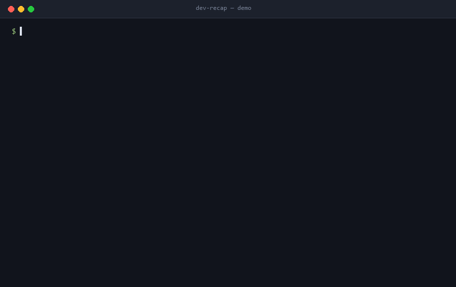

# dev-recap


**Turn your Git history into colorful terminal stats, hotspot charts, and clean `CHANGELOG.md` files in one command.**



## Features

- **Zero runtime dependencies** — instant `npx dev-recap` startup
- **Coding Activity & Streaks** — total commits, lines added/removed, active days, longest streak, and peak coding day/hour
- **Weekday ASCII Bar Chart** — see which days of the week your team ships the most
- **Conventional Commit Breakdown** — `feat`, `fix`, `docs`, `refactor`, `test`, `chore` distribution
- **File Hotspots** — find the most frequently modified files in your repository
- **Instant `CHANGELOG.md` Generator** — group commits cleanly with `--changelog`
- **CI/Script friendly** — `--json` output and `--days <n>` filtering

## Quick Start

```bash
npx dev-recap
```

Analyze any public GitHub repository remotely without cloning:

```bash
npx dev-recap BatuhanKlcky/dev-recap
```

Analyze only the last 30 days and show top 10 contributors/hotspots:

```bash
npx dev-recap --days 30 --top 10
```

Generate a `CHANGELOG.md` file:

```bash
npx dev-recap --changelog CHANGELOG.md
```

## Example Output

```text
  dev-recap — Git History & Hotspot Recap
  Repository: my-app (/path/to/my-app)

  Commits: 142   Lines: +8420 / -1930   Active Days: 28   Best Streak: 9d
  Peak Coding Time: Tue @ 21:00

  Activity by Weekday
    Mon  ████████████░░░░░░░░░░  24
    Tue  ██████████████████████  41
    Wed  ███████████████░░░░░░░  29
    Thu  █████████████░░░░░░░░░  25
    Fri  ██████████░░░░░░░░░░░░  18
    Sat  ██░░░░░░░░░░░░░░░░░░░░  3
    Sun  █░░░░░░░░░░░░░░░░░░░░░  2
```

## CLI Options

| Option | Description |
| :--- | :--- |
| `[target]` | Local git repository path, `owner/repo`, or GitHub URL (defaults to current working directory) |
| `--days <n>` | Only analyze commits from the last `<n>` days |
| `--top <n>` | Number of top contributors and hotspots to show (default: `5`) |
| `--changelog [file]` | Generate Markdown changelog (stdout if no file given) |
| `--json` | Output machine-readable JSON summary |
| `--no-color` | Disable ANSI terminal colors |
| `-h, --help` | Show help message |
| `-v, --version` | Show version number |

## GitHub Actions Usage

Use `dev-recap` directly in your workflow (use `fetch-depth: 0` so full commit history is available):

```yaml
- uses: actions/checkout@v4
  with:
    fetch-depth: 0
- uses: BatuhanKlcky/dev-recap@v1
  with:
    days: '30'
```

## Contributing

Contributions are welcome! Please read [CONTRIBUTING.md](CONTRIBUTING.md) before opening a Pull Request.

## License

This project is licensed under the [MIT License](LICENSE).
